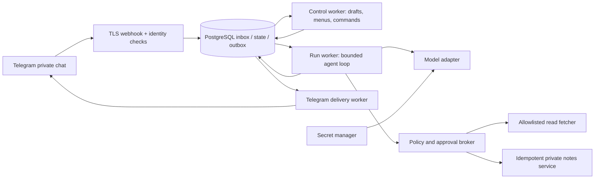
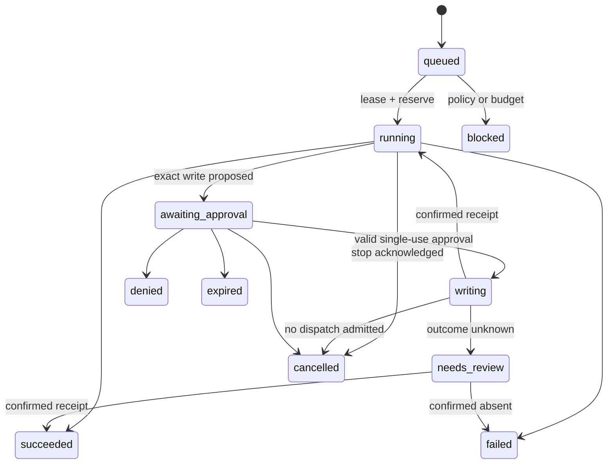

# 02 · Technical specification

**v0.1 · normative live-build design; prototype exceptions are explicit**

Repository version 0.2.0. This document describes the intended live service. The running bot implements the slice in the [readme](../README.md) and [deployment notes](DEPLOY.md).

## Architecture

Use a TypeScript modular monolith plus separate worker processes: grammY transport, Fastify HTTP boundary, PostgreSQL for authoritative state and transactional jobs/outbox, JSON Schema validation, OpenTelemetry metadata. Pin supported runtime/library versions and generate a lockfile at implementation. Start with one region and a managed database; Redis is unnecessary initially.

Choose the **OpenAI Agents SDK for TypeScript**, with application-owned orchestration, behind a replaceable runtime adapter. This workload needs durable user policy and approval control in our backend. The SDK’s runner/guardrails assist execution; they do not replace our broker or database checks. [SDK reference](https://openai.github.io/openai-agents-js/).

The model proposes actions. Only the broker can authorise and dispatch tools. The runtime has no Telegram bot token, tenant database superuser credentials, or unrestricted outbound access. Web content, tool results and user instructions cannot modify platform policy.

## Ingress and identity

Accept only private-chat messages/callbacks. Authenticate the webhook secret header with a timing-safe comparison; verify expected bot and payload shape; cap body size at 256 KB. Resolve the owner from Telegram’s numeric `from.id`, never username or model text. Bind private chat and resource ownership server-side. Unsupported group updates receive no workspace data.

In one transaction, persist a unique `(bot_id, update_id)` inbox row, then acknowledge HTTP. An unavailable database returns a retryable failure and executes nothing. Do not reject updates merely because their IDs are lower than the latest seen. Retain deduplication keys seven days; consumers are independently idempotent.

Every query includes owner/tenant context, including nested runs, versions, artifacts and callbacks. Composite foreign keys and PostgreSQL row-level policies add defence in depth; workers use scoped roles. Test two real tenants and deliberately substituted IDs.

## Telegram rendering contract

Use HTML formatting with escaped user/model content; limit rendered text to 4,096 characters and callback data to 64 bytes. Acknowledge callback queries promptly. Use the webhook secret header and handle Telegram rate-limit retry hints. These constraints follow the [Telegram Bot API](https://core.telegram.org/bots/api); recheck at adapter implementation.

Production callback data is `cb:<random token>`: 24 random bytes encoded base64url, with only its hash stored. Bind the record to owner, chat/message, resource, action, view revision, expiry and payload hash. Consume mutations atomically. The token is a lookup capability, not standalone authorisation. Normal menus expire after 15 minutes; approvals after ten. Old menus return a fresh view and never silently repeat an action.

Persist domain mutation, audit metadata and delivery intent in one transaction. One canonical control message per chat reduces clutter; run results and approvals get their own message IDs. A stale/deleted message falls back to a new canonical message. Serialise deliveries per chat and coalesce progress updates to at most one per second, subject to actual rate limits. An “unchanged message” response is success. Retry delivery independently of execution.

## Configuration and data

[harness.schema.json](../contracts/harness.schema.json) is the v1 configuration contract. Reject unknown fields recursively. Model profiles resolve at run start to an approved provider/model revision, token ceilings and price snapshot. Never accept an arbitrary API endpoint or model ID from user JSON.

| Entity           | Required fields / invariant                                                                                                     |
| ---------------- | ------------------------------------------------------------------------------------------------------------------------------- |
| Owner            | Internal ID, Telegram user ID unique, private chat ID, notification state, account quota                                        |
| Harness          | Owner, ID, active version, paused flag, capability epoch, row revision, deletion state                                          |
| HarnessVersion   | Harness/owner, monotonically increasing version, canonical config, SHA-256 hash, created time; immutable                        |
| DraftSession     | Owner/chat, draft JSON, base version, UI revision, cursor, expiry (24h); separate from active config                            |
| Inbox / Callback | Unique update key; hashed token and complete action binding; processing/consumption state                                       |
| Run              | Owner/harness, pinned version/hash + model catalogue snapshot, task ref, state, step count, deadlines, lease/fence, usage state |
| Approval         | Run/step, tool, destination, canonical payload hash, capability epoch, expires time, decision; single use                       |
| ToolEffect       | `(run, step, tool call)` unique, idempotency key, payload hash, dispatch state, connector receipt                               |
| BudgetLedger     | Owner/harness/day accounts, integer USD micro-units, reservations, actual usage, unresolved charges                             |
| Outbox / Job     | Stable unique key, payload ref, attempts, next attempt, lease, delivery/terminal state                                          |
| Audit / Artifact | Owner, run/version/action metadata and outcome; encrypted content in separate artifact store                                    |

The configuration expresses user budgets in integer cents. Convert to integer micro-units for provider accounting. Avoid floating-point accounting. All FKs carry tenant scope. Log correlation IDs and error codes, never credentials, raw prompts, webhook URLs containing tokens or full tool payloads.

Commit a draft only if `active_version == base_version`; conflict returns Review latest / Start fresh. Restoring a historical configuration creates the next version after current policy revalidation. Existing runs retain pinned behaviour, but current pause/revocation and platform deny rules always override a historical grant.

## Run and approval protocol

`pausing` is a control transition while existing dispatches settle; it is not permission for another step. A budget breach during a run ends as `blocked` with a partial result and `BUDGET_EXCEEDED`. The prototype combines queued/running, then ends immediately after its sample note; its status names otherwise map to this flow.

1. Start uses a server-side idempotency key bound to owner, task hash and version. Acquire per-harness concurrency slot: one active run per harness, at most two per owner. Repeated delivery returns the same run.
2. Freeze config/model catalogue. Count **every model request and tool dispatch** as a runtime step; serial tool proposals only. Default eight steps, model input ≤4,000 tokens and output ≤1,000 tokens. Reject work exceeding approved token/step/time bounds.
3. Before each cost-incurring action, atomically reserve its conservative upper cost against run, harness-day and account-day accounts, including existing reservations. Reconcile known usage; keep unknown charges reserved. No approved cost bound or stale pricing means no new work.
4. For a write, canonicalise parameters and create a ten-minute approval containing the exact destination/content. Bind owner, run, step, config hash, tool/payload hash and current capability epoch. Large content is reviewed as a complete artifact, not an ambiguous truncated preview.
5. On decision, transactionally verify state, identity, expiry, binding, current policy, pause status and budget. Consume approval once and write an effect intent. The broker rechecks the grant when admitting dispatch. A changed payload requires a new approval.
6. Notes service accepts an idempotency key and returns a stored receipt. A repeated identical key returns the receipt; a changed payload with the same key fails. External connectors without deduplication/receipt lookup are not eligible for MVP writes.
7. If dispatch may have happened and the response is lost, enter `needs_review`. Reconcile by receipt lookup before allowing dependent work. **Never retry an uncertain write blindly.** “Exactly once” cannot be promised across arbitrary services.

Active time excludes approval waiting and is not replenished on resume. Absolute run wall limit is 30 minutes. Expiry workers use database UTC time; late clicks are checked synchronously too. Worker leases and increasing fencing tokens prevent stale workers from committing. Crash recovery examines effect intents and receipts before resuming execution. Do not restart a potentially accepted provider request without accounting for its unresolved cost.

Pause commits a capability-epoch increment and blocks new runs/tool intents. Invalidate pending approvals. A tool already admitted may finish; record its eventual result and costs. Stop cannot undo completed work. “Pause all” affects only the requesting owner’s workspace. Cancellation is a durable request with a visible acknowledgement, not a claim that a remote action has vanished.

## Tools and memory

`web.fetch` accepts HTTPS hostnames in the allowlist. The broker rejects private/link-local/reserved IPv4 and IPv6 targets, metadata endpoints, credentials in URLs, unsafe ports and redirects outside policy. Resolve and validate each connection/redirect, pin the validated target while preserving TLS host verification, and enforce egress policy independently. Limit responses to 1 MB, three redirects and ten seconds; no browser cookies or active scripts. Treat extracted text as untrusted data.

`notes.write` writes only the owner’s private note namespace, with a complete approval preview and durable deduplication. No arbitrary paths or cross-user destinations.

Memory Off retains only the task context needed for execution; Run memory adds a temporary scratchpad. Clear execution context/scratchpad on terminal outcome; retained user-facing history is a separate setting. Encrypt checkpoints and resume data. Cross-run memory is deferred and must have inspect/delete controls before release.

## Failure contract

All user errors contain: what happened, what is known about effects, and one safe next action. Operator logs add a correlation ID and redacted diagnostics.

| Code                                 | User recovery                     | Execution rule                                                         |
| ------------------------------------ | --------------------------------- | ---------------------------------------------------------------------- |
| `INPUT_INVALID` / `MENU_STALE`       | Fix this field / Open latest menu | No mutation or side effect                                             |
| `VERSION_CONFLICT`                   | Review latest version             | Preserve draft; no overwrite                                           |
| `AUTH_DENIED`                        | Return to own workspace           | No resource existence disclosure                                       |
| `BUDGET_EXCEEDED`                    | Review limits or wait for reset   | No unreserved step; keep partial result                                |
| `PROVIDER_RATE_LIMIT`                | Retry after displayed delay       | Honour retry hints; at most three safe attempts with cost reservations |
| `PROVIDER_TIMEOUT` / `RUN_TIMEOUT`   | Review status and usage           | Hold uncertain charges; no implicit tool retry                         |
| `APPROVAL_EXPIRED` / `POLICY_DENIED` | Review a new action               | No write admitted                                                      |
| `OUTCOME_UNKNOWN`                    | Check outcome                     | Receipt lookup, never repeat write blindly                             |
| `DELIVERY_FAILED`                    | Retry delivery / Open history     | Re-send stored result only                                             |
| `DEPENDENCY_UNAVAILABLE`             | Try again when restored           | Fail closed if identity/policy/budget state is unavailable             |

Retry only confirmed transient, safe operations; bounded exponential backoff with jitter, cancellation and deadlines. Invalid credentials/configuration and permission errors do not loop. Persist exhausted jobs for operator review. A blocked bot disables notifications without deleting the workspace. Plain-text fallback handles render errors without re-running the task.

## Privacy, operations and trust boundaries

Bot chats are not end-to-end encrypted; explain this before users submit sensitive content. Secrets stay in a managed secret store, with least-privilege workload access and rotation. Scrub telemetry and disable SDK content tracing unless an explicit, redacted collection policy is implemented.

Proposed retention: task/result content 24h, requested downloadable artifacts seven days, private notes until deleted, redacted audit metadata 30 days, encrypted backups seven days. Deletion first revokes grants/stops new work, then removes active content within 24h; tombstones prevent backup restore from resurrecting deleted work. Explain backup expiry. Rate-limit signups/messages/runs and enforce aggregate account quotas.

Deploy API and workers separately with least privilege, non-root processes, bounded resources and health/readiness endpoints. Worker overload queues bounded work; admission reports busy rather than accepting unlimited jobs. Observe queue age, approval latency, stale leases, unresolved effects/charges, delivery backlog and reservation drift. Practise database restore and provider-outage drills. The kill switch disables new admission while retaining reconciliation workers.

Future BYOK must use a dedicated HTTPS setup surface, not chat. If implemented as a Mini App, validate Telegram `initData` on the server, enforce freshness and one-time setup binding, then store credentials only in the vault. Follow [Telegram’s validation protocol](https://core.telegram.org/bots/webapps#validating-data-received-via-the-mini-app). It is not part of this prototype.

## Prototype boundary

`core.mjs` is a deterministic state machine with fixture results, integer-cent demo accounting, read-only config exports and local browser persistence. It exercises revision checks and approval semantics. It does not implement authenticated tokens, row locks, durable effect receipts, network policy or multi-process execution. The demo permits one active run in the whole workspace and caps history at 100 runs. Local state is inspectable/editable; it is not a vault or an authority for live execution.
