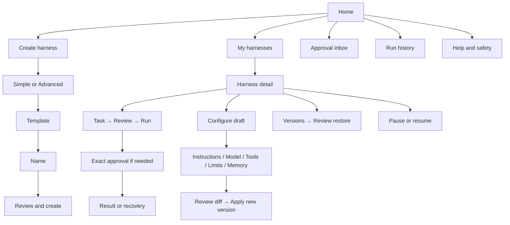

# 03 · Design blueprint

**Design direction:** calm, precise, friendly. A capable control room that feels like a conversation.

Repository version 0.2.0. Dialogue in the bot follows this blueprint where the MVP implements the screen. The browser prototype is not a security boundary.

## Information architecture



Home is always reachable through the bot menu. It retains a draft. Only one draft is edited per owner in MVP; finishing/discarding it avoids conflicting wizards. Unsolicited text gets “Choose a button first, then type when asked.” `/start`, `/help` and `/cancel` remain accessibility/recovery fallbacks in the live transport.

## Screen rules

| Screen          | Main content                                    | Primary action         | Recovery                       |
| --------------- | ----------------------------------------------- | ---------------------- | ------------------------------ |
| Home            | Harness count, pending approvals, brief promise | Create harness         | Help, history, continue draft  |
| Setup           | One decision, progress “1 of 4”                 | Named choice           | Back; Home preserves draft     |
| Harness         | Name, state, active version, effective limits   | Run a task             | Configure, pause, versions     |
| Configure       | Clear Draft label and effective settings        | Review changes         | Discard draft                  |
| Review          | Changed fields with before/after values         | Apply new version      | Keep editing                   |
| Run review      | Exact task, version, spend cap, enabled tools   | Start run              | Edit task, Cancel              |
| Approval        | Tool, destination, complete content, expiry     | Approve once           | Decline, inspect full artifact |
| Run status      | Plain-language state, run ID, version, usage    | Contextual next action | Stop, history, recovery        |
| Uncertain write | What may already have happened                  | Check outcome          | Operator help if unresolved    |
| Pause all       | Workspace scope and effect                      | Pause all now          | Home                           |

Button labels name the action: “Apply new version”, “Approve once”, “Retry delivery only”. Avoid ambiguous “OK”, “Proceed” and “Yes”. No setting saves implicitly. Advanced view does not conceal policy or reset custom settings when switching views.

## Message anatomy

Use a bold title, one short explanation, a compact status block and the keyboard. Aim for 400–900 characters on common screens; use detail views for long instructions. No ASCII art tables in chat. Spell out units and use locale-readable dates. Telegram themes control the actual font, bubble and button presentation; the preview’s green styling is illustrative.

```text
Research companion
Ready · version 3

Balanced model · 8 steps · 90s active time
$0.50 / run · $5.00 / day (resets 00:00 UTC)
Web: selected sites · Notes: ask every time

[ Run a task ]
[ Configure ] [ Pause harness ]
[ Versions ] [ Run history ]
[ Export config ] [ Home ]
```

The live bot sends ordinary Telegram messages and inline keyboards. The desktop explainer, fault selector and state inspector belong to the prototype workbench; they are not proposed Telegram screens.

## Dialogue examples

**Welcome:** “Create an agent, give it boundaries, and stay in control of every run.”

**Approval:** “Save one private note? Destination: private/summary. [Complete content.] Approve this exact note once. This permission expires at 14:35.” Show a date/time in the user’s selected timezone, with UTC available in details.

**Budget:** “The next step would exceed your $0.50 limit. The run stopped before that step. Review the partial result or change the limit for a new run.”

**Lost response:** “The note tool accepted the request, but its response was lost. The note may already be saved. Check the outcome before starting another write.”

**Pause:** “New runs are blocked. A tool already started may still finish; its outcome will appear here.”

**Expired menu:** “That button is out of date. Here’s the latest menu.” Never expose stack traces or ask the user to diagnose infrastructure.

## Visual and accessibility direction

The prototype uses warm off-white `#F5F6F0`, deep green `#123F37`, muted green panels and restrained lime accents. Use one dominant action per screen, consistent spacing, clear state labels and text alongside colour. Replace decorative glyphs with SVG where font support is uncertain. Telegram itself keeps native platform typography and accessibility settings.

Browser preview: keyboard navigation, visible focus, semantic headings/labels, polite status announcements, reduced-motion support and responsive 320–1440 px layouts. Preview button sizing is illustrative; validate native touch targets in Telegram iOS, Android and Desktop. Essential copy never relies on emoji or colour. Localised text must tolerate roughly 30% expansion; pagination avoids oversized keyboards.

## Walkthroughs and edge cases

1. **First use:** create Simple → template → name → review → create → sample task → review → run → result. No tool permission is enabled implicitly.
2. **Customise:** Configure → enable Save notes → review diff → apply → run → approve/decline. Show the configuration version at every step.
3. **Recover:** select a next-run scenario in the workbench. Provider timeout offers a reviewed new run; budget stops early; expired approval writes nothing; delivery retry reuses the result; unknown write uses receipt reconciliation.
4. **Return later:** restore a valid browser snapshot, expire overdue approvals immediately, reopen the current menu. Invalid storage opens a fresh demo with an explanation; blocked storage keeps the session usable in memory.
5. **Exit safely:** stop a run, pause a harness or confirm Pause all. Restore a historical config as a new version. A live Delete harness flow must name the harness, explain content removal and require explicit confirmation; it is specified, not simulated.

## Prototype assets

[Standalone preview](../Relay-Prototype.html), [desktop screenshot](../evidence/desktop-home.png), [mobile screenshot](../evidence/mobile-home.png) and [approval screenshot](../evidence/approval.png). The shared renderer also exposes a Telegram payload fixture for every simulated screen, so the build can preserve the exact dialogue and keyboard layout.
